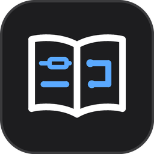
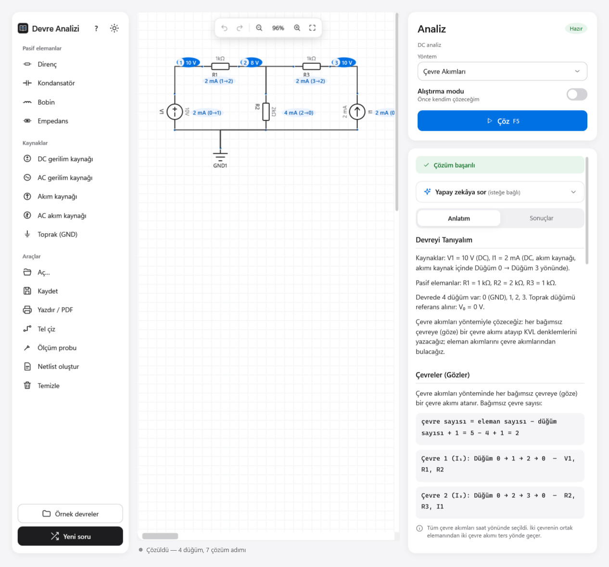
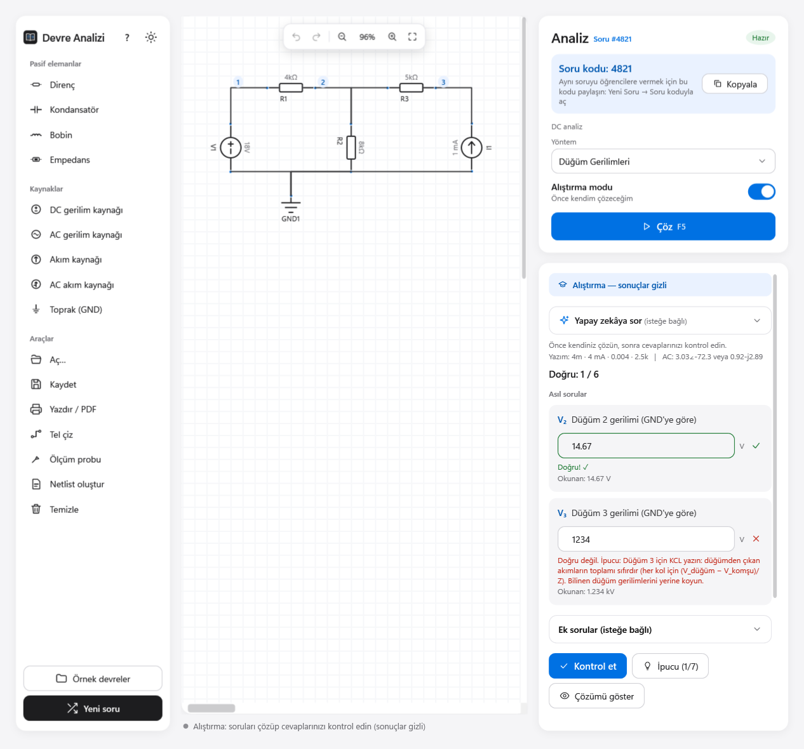
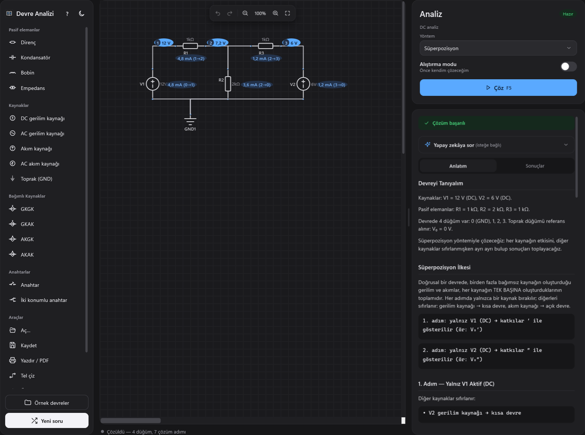
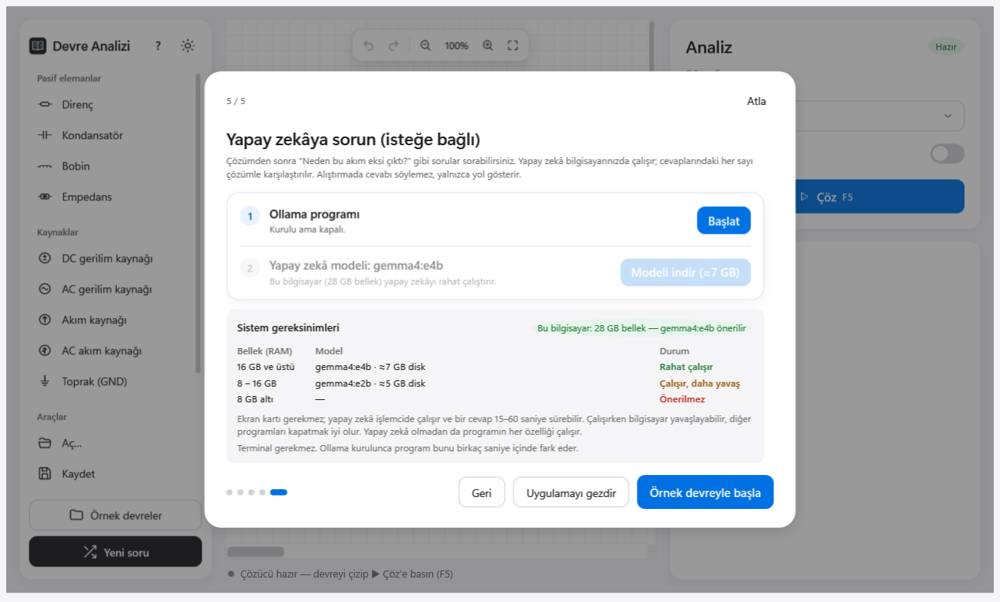
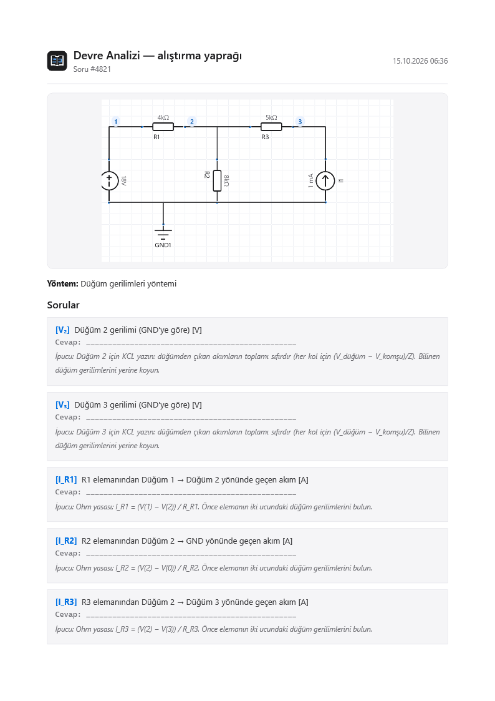

<p align="center">
  
</p>

<h1 align="center">Devre Analizi</h1>

<p align="center">
  Elektronik öğrencileri için <b>ücretsiz</b>, <b>açık kaynak</b> ve <b>internetsiz çalışan</b> devre analizi programı.<br>
  Devreyi çizin; program kesin olarak çözer ve her adımı <b>Türkçe</b> anlatır.
</p>

<p align="center">
  <a href="../../releases/latest"><b>⬇ Son sürümü indir</b></a> ·
  <a href="#nasıl-kullanılır">Nasıl kullanılır?</a> ·
  <a href="#yapay-zekâ-yardımcısı-isteğe-bağlı">Yapay zekâ</a> ·
  <a href="#sorumluluk-reddi">Sorumluluk reddi</a>
</p>

https://github.com/user-attachments/assets/8298aa93-6456-4b34-bcca-171816584310

<p align="center">
  
</p>

<table>
  <tr>
    <td width="50%"><br><sub><b>Alıştırma modu</b> — cevabınızı yazın; yanlışsa neden yanlış olduğunu söyler.</sub></td>
    <td width="50%"><br><sub><b>Koyu tema</b> — süperpozisyonla çözülmüş iki kaynaklı devre.</sub></td>
  </tr>
  <tr>
    <td width="50%"><br><sub><b>İsteğe bağlı yapay zekâ</b> — terminal açmadan, bilgisayarınıza uygun modelle.</sub></td>
    <td width="50%"><br><sub><b>Alıştırma yaprağı</b> — soruları cevapsız yazdırın ya da PDF olarak kaydedin.</sub></td>
  </tr>
</table>

---

## Neler yapabilir?

- **Sürükle-bırak devre çizimi:** direnç, kondansatör, bobin, empedans, DC/AC gerilim ve akım kaynakları, toprak ve ölçüm probu.
- **Kesin çözüm:** sonuçlar sembolik matematik motoruyla (lcapy + SymPy) hesaplanır; yaklaşık değil, kesin değerler.
- **Adım adım Türkçe anlatım:** düğüm gerilimleri, çevre akımları, Thevenin/Norton eşdeğeri, süperpozisyon ve maksimum güç aktarımı, ders kitabındaki gibi adım adım; her adım kendi içinde sağlaması yapılarak.
- **DC ve AC (fazör) devreler:** farklı frekanslı kaynaklar süperpozisyonla ayrı ayrı çözülür.
- **Alıştırma modu:** program soru sorar, siz cevabı yazarsınız (`1k5`, `2,5 mA`, `10∠30°` gibi). Yanlışsa *neden* yanlış olduğunu söyler: işaret hatası, birim öneki, tepe/etkin değer karışıklığı…
- **Soru kodları:** "Yeni soru" ile rastgele devre üretin. Her sorunun 4 haneli bir kodu vardır; öğretmen kodu paylaşır, bütün sınıf aynı soruyu açar.
- **Kaydet / aç** (`.devre` dosyası), **geri al / yinele**, **yakınlaştırma**, **yazdır / PDF olarak kaydet** (alıştırma kâğıdı olarak da).
- **Açık ve koyu tema**, ilk açılışta kısa bir tanıtım ve uygulama turu.

## Kurulum

1. [Releases](../../releases/latest) sayfasından `DevreAnalizi-Kurulum-x.y.z.exe` dosyasını indirin.
2. Çift tıklayın. Kurulum **yönetici izni istemez**; yalnızca sizin kullanıcı hesabınıza kurulur (okul bilgisayarlarında da çalışır).
3. Kullanım koşullarını okuyup kabul edin, **Kur**'a basın. Hepsi bu: Python ya da başka bir program kurmanız gerekmez.

> **"Windows kişisel bilgisayarınızı korudu" uyarısı çıkarsa:** Program ücretsiz olduğu için pahalı bir dijital imza sertifikasıyla imzalanmamıştır; Windows bu yüzden uyarır. **Ek bilgi → Yine de çalıştır**'a basabilirsiniz. Emin olmak isterseniz kaynak kodun tamamı bu sayfadadır.

**Sistem gereksinimleri:** Windows 10 veya 11 (64 bit), yaklaşık 250 MB boş disk alanı (indirme yaklaşık 70 MB). İnternet gerekmez.

## Nasıl kullanılır?

1. Soldaki listeden bir elemana tıklayın ve çizim alanına yerleştirin. Bağlamak için **Tel çiz**'i seçip iki ucu sırayla tıklayın (bitirince Esc).
2. Bir **toprak** (GND) eklemeyi unutmayın; gerilimler ona göre ölçülür.
3. Sağ panelden yöntemi seçin (Düğüm gerilimleri, Çevre akımları, Thevenin…) ve **Çöz**'e basın.
4. **Anlatım** sekmesinde çözümü adım adım okuyun; değerler devrenin üzerinde de görünür.

Takıldığınızda **?** düğmesinden tanıtımı ve uygulama turunu yeniden açabilirsiniz. Hazır örnek devrelerle başlamak da iyi bir fikir.

## Yapay zekâ yardımcısı (isteğe bağlı)

Çözümle ilgili "Bu akım neden negatif çıktı?" gibi sorularınızı Türkçe sorabileceğiniz bir yardımcı vardır. **Tamamen isteğe bağlıdır**; program onsuz da eksiksiz çalışır.

- Yardımcı **sizin bilgisayarınızda** çalışır (Ollama + Gemma 4 modeli). Sorularınız hiçbir yere gönderilmez.
- Kurulum programın içinden, terminal açmadan yapılır: **Ollama'yı indir** düğmesi resmi indirme sayfasını açar, ardından **Modeli indir** düğmesi modeli indirir (ilerleme çubuğuyla).
- Program bilgisayarınızın belleğine göre uygun modeli kendisi seçer:

| Bellek (RAM) | Model | İndirme boyutu |
|---|---|---|
| 16 GB ve üstü | gemma4:e4b | yaklaşık 6,6 GB |
| 8–16 GB | gemma4:e2b | yaklaşık 4,6 GB |
| 8 GB'tan az | önerilmez | — |

- Yanıtlardaki sayılar programın kesin çözümüyle karşılaştırılır; tutmayan sayılar gizlenir. Yine de küçük modeller kavramsal hatalar yapabilir. **Yardımcıyı bir öğretmen yerine değil, ipucu veren bir arkadaş gibi kullanın.**

Ollama (MIT) ve Gemma 4 (Apache 2.0) programla birlikte dağıtılmaz; kurarsanız kendi lisans koşulları geçerlidir.

## Gizlilik

Program internete bağlanmaz ve hiçbir kişisel veri toplamaz. Reklam, hesap, takip yoktur. İnternet yalnızca siz isterseniz, Ollama'yı ve yapay zekâ modelini indirirken kullanılır.

## Sorumluluk reddi

Bu program bilgi paylaşımı ve eğitim amacıyla hazırlanmıştır. Olduğu gibi sunulur; doğruluğu, eksiksizliği veya belirli bir amaca uygunluğu konusunda hiçbir garanti verilmez. Sonuçları kendiniz kontrol edin. Programın kullanımından doğabilecek her türlü sonuçtan kullanıcı sorumludur; geliştirici sorumlu tutulamaz. Bu koşulları kabul etmiyorsanız programı kullanmayın.

## Lisans

Devre Analizi [MIT Lisansı](LICENSE) ile dağıtılır: ücretsiz kullanabilir, kopyalayabilir, değiştirebilir ve paylaşabilirsiniz; yalnızca telif ve lisans notunu korumanız yeterlidir.

Program, açık kaynak bileşenler kullanır (.NET, Python, lcapy, SymPy, NumPy, FastAPI ve diğerleri). Tam liste ve lisansları: [THIRD_PARTY_NOTICES.md](THIRD_PARTY_NOTICES.md). lcapy, [LGPL 2.1](licenses/LGPL-2.1.txt) ile lisanslıdır ve değiştirilmeden kullanılır.

---

## Geliştiriciler için

Program iki parçadan oluşur:

| Klasör | Ne yapar? | Teknoloji |
|---|---|---|
| `CircuitAnalyzer.WPF` | Çizim arayüzü, paneller, alıştırma modu | C# · .NET 8 · WPF |
| `CircuitAnalyzer.API` | Çözücü, Türkçe anlatım, cevap denetimi, yapay zekâ bağlantısı | Python · FastAPI · lcapy |
| `CircuitAnalyzer.Tests` | Arayüz ve uçtan uca testler | xUnit |
| `installer` | Kurulum paketi (PyInstaller + Inno Setup) | PowerShell |

Arayüz, çözücüyü arka planda kendisi başlatır (geliştirme sırasında `python -m uvicorn main:app`, kurulu sürümde `backend\CircuitAnalyzerAPI.exe`).

**Kaynaktan çalıştırma:** .NET 8 SDK ve Python 3.10+ gerekir.

```bash
pip install -r CircuitAnalyzer.API/requirements-dev.txt
dotnet run --project CircuitAnalyzer.WPF
```

**Testler:**

```bash
cd CircuitAnalyzer.API && python -m pytest -q
dotnet test CircuitAnalyzer.Tests
```

**Kurulum paketi üretme** (ek olarak `pip install pyinstaller` ve [Inno Setup 6](https://jrsoftware.org/isinfo.php) gerekir):

```bash
powershell -ExecutionPolicy Bypass -File installer/build.ps1 -Version 1.0.0
```

Çıktı: `build/installer/DevreAnalizi-Kurulum-1.0.0.exe`.

Hata bildirimleri ve öneriler için [Issues](../../issues) sayfasını kullanabilirsiniz.
