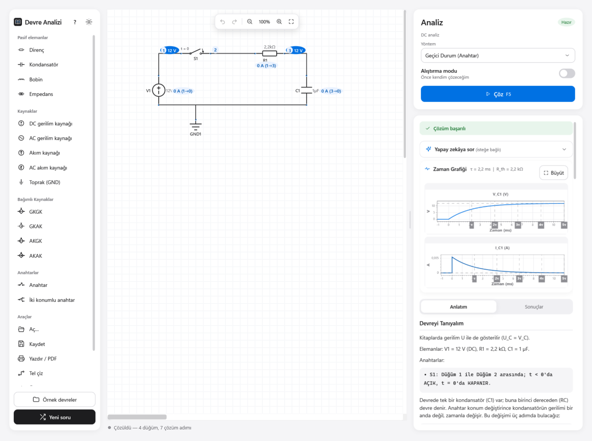
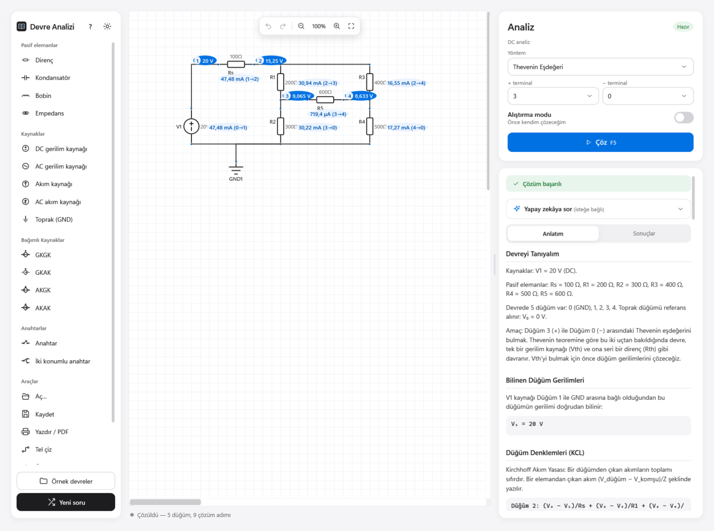
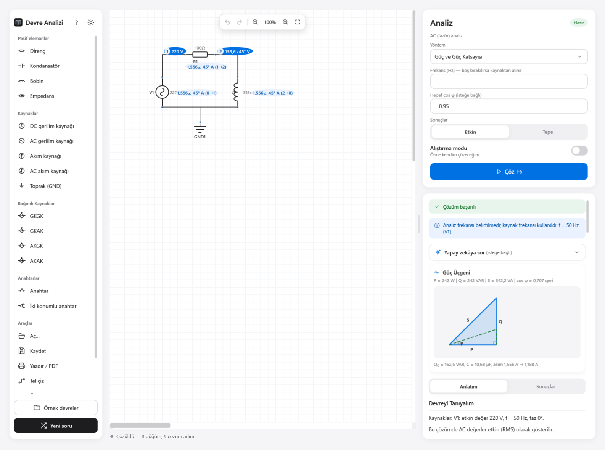
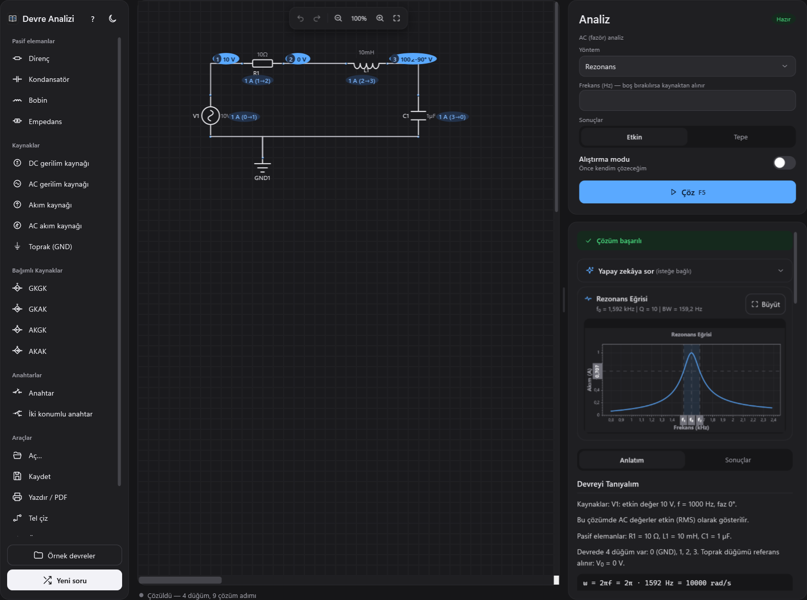

<p align="center">
  
</p>

<h1 align="center">Devre Analizi</h1>

<p align="center">
  Elektronik öğrencileri için <b>ücretsiz</b>, <b>açık kaynak</b> ve <b>internetsiz çalışan</b> devre analizi programı.<br>
  Devreyi çizin; program kesin olarak çözer ve her adımı <b>ders kitabındaki sırayla, Türkçe</b> anlatır.
</p>

<p align="center">
  <a href="../../releases/latest"></a>
  <a href="../../releases"></a>
  
  <a href="LICENSE"></a>
</p>

<p align="center">
  <a href="../../releases/latest"><b>⬇ Son sürümü indir</b></a> ·
  <a href="../../wiki">📖 Kullanım rehberi (Wiki)</a> ·
  <a href="../../wiki/S%C4%B1k%C3%A7a-Sorulan-Sorular">❓ Sıkça sorulanlar</a> ·
  <a href="../../issues">💬 Hata bildir / öneri</a>
</p>

https://github.com/user-attachments/assets/8298aa93-6456-4b34-bcca-171816584310

<p align="center">
  
</p>

<table>
  <tr>
    <td width="25%" align="center"><b>Ücretsiz ve açık kaynak</b><br><sub>Reklam yok, hesap yok, ücret yok. Kaynak kodun tamamı burada.</sub></td>
    <td width="25%" align="center"><b>İnternetsiz çalışır</b><br><sub>Kurduktan sonra internete hiç ihtiyaç duymaz; okul laboratuvarında da çalışır.</sub></td>
    <td width="25%" align="center"><b>Adım adım Türkçe</b><br><sub>Denklemleri kurar, sayıları yerine koyar, sonucu kendi içinde sağlar.</sub></td>
    <td width="25%" align="center"><b>Kesin sonuç</b><br><sub>Sembolik matematik motoruyla çözer; yaklaşık değil, kesin değerler.</sub></td>
  </tr>
</table>

## Hangi yöntemlerle çözer?

| Yöntem | Ne bulursunuz? | Rehber |
|---|---|---|
| **Düğüm gerilimleri** | Bütün düğüm gerilimleri ve eleman akımları (bağımlı kaynaklar ve Cramer kuralıyla) | [Wiki](../../wiki/Düğüm-Gerilimleri) |
| **Çevre akımları** | Göz (çevre) akımları ve eleman akımları | [Wiki](../../wiki/Çevre-Akımları) |
| **Thevenin / Norton** | İki uç arasındaki eşdeğer devre ve maksimum güç aktarımı | [Wiki](../../wiki/Thevenin-ve-Norton) |
| **Süperpozisyon** | Her kaynağın ayrı katkısı ve toplamı (farklı frekanslı AC kaynaklar dahil) | [Wiki](../../wiki/Süperpozisyon) |
| **Millman** | Paralel kollu devrelerde iki düğüm arası gerilim, tek formülle | [Wiki](../../wiki/Millman) |
| **Kaynak dönüşümü** | Gerilim ⇄ akım kaynağı dönüşümleriyle sadeleştirme, gerekirse Δ–Y | [Wiki](../../wiki/Kaynak-Dönüşümü) |
| **Geçici durum (anahtar)** | Kondansatör/bobin şarj–deşarjı: τ, x(t) formülü, τ tablosu, enerji ve zaman grafiği | [Wiki](../../wiki/Geçici-Durum) |
| **Güç ve güç katsayısı** | P, Q, S, cos φ, güç üçgeni ve kompanzasyon kondansatörü | [Wiki](../../wiki/Güç-ve-Güç-Katsayısı) |
| **Rezonans** | f₀, Q, bant genişliği, kesim frekansları ve frekans eğrisi (seri, paralel, seri R + paralel LC) | [Wiki](../../wiki/Rezonans) |

DC ve AC (fazör) devrelerin hepsinde çalışır; AC değerleri [etkin ya da tepe](../../wiki/Etkin-ve-Tepe-Değer) olarak girip gösterebilirsiniz. Köprü gibi seri/paralele indirgenemeyen devrelerde **Δ–Y (üçgen–yıldız) dönüşümü** kendiliğinden devreye girer.

## Öne çıkanlar

<table>
  <tr>
    <td width="50%"><br><sub><b>Alıştırma modu</b> — önce siz çözün. Yanlışsa <i>neden</i> yanlış olduğunu söyler: işaret hatası, birim öneki, tepe/etkin değer karışıklığı…</sub></td>
    <td width="50%"><br><sub><b>Δ–Y dönüşümü</b> — Wheatstone köprüsünün Thevenin eşdeğeri, adım adım.</sub></td>
  </tr>
  <tr>
    <td width="50%"><br><sub><b>Güç üçgeni ve kompanzasyon</b> — hedef cos φ için gereken kondansatör, devre yeniden çözülerek doğrulanır.</sub></td>
    <td width="50%"><br><sub><b>Rezonans ve koyu tema</b> — f₀, Q, bant genişliği ve frekans eğrisi.</sub></td>
  </tr>
  <tr>
    <td width="50%"><br><sub><b>İsteğe bağlı yapay zekâ</b> — "Bu akım neden negatif?" diye sorun; sizin bilgisayarınızda çalışır.</sub></td>
    <td width="50%"><br><sub><b>Alıştırma yaprağı</b> — soruları cevapsız yazdırın ya da PDF olarak kaydedin.</sub></td>
  </tr>
</table>

**Ayrıca:** sürükle-bırak çizim · bağımlı kaynaklar (GKGK, GKAK, AKGK, AKAK) · anahtarlar (t = 0) · ölçüm probu · hazır örnek devreler · 4 haneli **soru kodları** (öğretmen kodu paylaşır, bütün sınıf aynı soruyu açar) · kaydet/aç (`.devre`) · geri al/yinele · yazdır/PDF · ondalık virgül (`4,7k` de `4.7k` de yazılabilir) · açık ve koyu tema.

## Kurulum

1. [Releases](../../releases/latest) sayfasından `DevreAnalizi-Kurulum-x.y.z.exe` dosyasını indirin.
2. Çift tıklayın. Kurulum **yönetici izni istemez**; yalnızca sizin kullanıcı hesabınıza kurulur (okul bilgisayarlarında da çalışır).
3. Kullanım koşullarını okuyup kabul edin, **Kur**'a basın. Python ya da başka bir program kurmanız gerekmez.

> **"Windows kişisel bilgisayarınızı korudu" uyarısı çıkarsa:** Program ücretsiz olduğu için pahalı bir dijital imza sertifikasıyla imzalanmamıştır; Windows bu yüzden uyarır. **Ek bilgi → Yine de çalıştır**'a basabilirsiniz. Her sürümün notlarında dosyanın SHA-256 doğrulama kodu da yazar.

**Sistem gereksinimleri:** Windows 10 veya 11 (64 bit), yaklaşık 250 MB boş disk alanı (indirme yaklaşık 75 MB). İnternet gerekmez.

## Hızlı başlangıç

1. Soldaki listeden bir elemana tıklayın, çizim alanında yerine bırakın. Bağlamak için bir elemanın **ucuna**, sonra bağlanacak uca tıklayın.
2. Bir **toprak (GND)** eklemeyi unutmayın; gerilimler ona göre ölçülür.
3. Sağ panelden yöntemi seçin ve **Çöz**'e (F5) basın.
4. **Anlatım** sekmesinde çözümü adım adım okuyun; değerler devrenin üzerinde de görünür.

İlk kez kullanıyorsanız **Örnek devreler** düğmesiyle başlayın. Ayrıntılar, ipuçları ve klavye kısayolları için: **[Kullanım rehberi (Wiki)](../../wiki)**.

## Yapay zekâ yardımcısı (isteğe bağlı)

Çözümle ilgili sorularınızı Türkçe sorabileceğiniz bir yardımcı vardır. **Tamamen isteğe bağlıdır**; program onsuz da eksiksiz çalışır.

- Yardımcı **sizin bilgisayarınızda** çalışır (Ollama + Gemma 4). Sorularınız hiçbir yere gönderilmez.
- Kurulum program içinden, terminal açmadan yapılır; program belleğinize uygun modeli kendisi seçer (8 GB RAM ve üstü önerilir).
- Yanıtlardaki sayılar programın kesin çözümüyle karşılaştırılır; tutmayanlar için uyarır, alıştırma modunda cevabı veren sayıları gizler. **Yardımcıyı bir öğretmen yerine değil, ipucu veren bir arkadaş gibi kullanın.**

Ayrıntılar: [Yapay zekâ yardımcısı](../../wiki/Yapay-Zekâ-Yardımcısı). Ollama (MIT) ve Gemma 4 (Apache 2.0) programla birlikte dağıtılmaz; kurarsanız kendi lisans koşulları geçerlidir.

## Gizlilik

Program internete bağlanmaz ve hiçbir kişisel veri toplamaz. Reklam, hesap, takip yoktur. İnternet yalnızca siz isterseniz, Ollama'yı ve yapay zekâ modelini indirirken kullanılır.

## Sorumluluk reddi

Bu program bilgi paylaşımı ve eğitim amacıyla hazırlanmıştır. Olduğu gibi sunulur; doğruluğu, eksiksizliği veya belirli bir amaca uygunluğu konusunda hiçbir garanti verilmez. Sonuçları kendiniz kontrol edin. Programın kullanımından doğabilecek her türlü sonuçtan kullanıcı sorumludur; geliştirici sorumlu tutulamaz. Bu koşulları kabul etmiyorsanız programı kullanmayın.

## Lisans

Devre Analizi [MIT Lisansı](LICENSE) ile dağıtılır: ücretsiz kullanabilir, kopyalayabilir, değiştirebilir ve paylaşabilirsiniz; yalnızca telif ve lisans notunu korumanız yeterlidir.

Program, açık kaynak bileşenler kullanır (.NET, Python, lcapy, SymPy, NumPy, FastAPI, ScottPlot ve diğerleri). Tam liste ve lisansları: [THIRD_PARTY_NOTICES.md](THIRD_PARTY_NOTICES.md). lcapy, [LGPL 2.1](licenses/LGPL-2.1.txt) ile lisanslıdır ve değiştirilmeden kullanılır.

---

<details>
<summary><b>Geliştiriciler için</b> (kaynaktan çalıştırma, testler, kurulum paketi)</summary>

<br>

Program iki parçadan oluşur:

| Klasör | Ne yapar? | Teknoloji |
|---|---|---|
| `CircuitAnalyzer.WPF` | Çizim arayüzü, paneller, alıştırma modu, zaman grafiği | C# · .NET 8 · WPF · ScottPlot |
| `CircuitAnalyzer.API` | Çözücü, Türkçe anlatım, cevap denetimi, yapay zekâ bağlantısı | Python · FastAPI · lcapy |
| `CircuitAnalyzer.Tests` | Arayüz ve uçtan uca testler | xUnit |
| `installer` | Kurulum paketi (PyInstaller + Inno Setup) | PowerShell |

Arayüz, çözücüyü arka planda kendisi başlatır (geliştirme sırasında `python -m uvicorn main:app`, kurulu sürümde `backend\CircuitAnalyzerAPI.exe`).

**Kaynaktan çalıştırma:** .NET 8 SDK ve Python 3.10+ gerekir.

```bash
pip install -r CircuitAnalyzer.API/requirements-dev.txt
dotnet run --project CircuitAnalyzer.WPF
```

**Testler:**

```bash
cd CircuitAnalyzer.API && python -m pytest -q
dotnet test CircuitAnalyzer.Tests
```

**Kurulum paketi üretme** (ek olarak `pip install pyinstaller` ve [Inno Setup 6](https://jrsoftware.org/isinfo.php) gerekir). Sürüm numarası `CircuitAnalyzer.WPF/CircuitAnalyzer.WPF.csproj` içindeki `<Version>` satırından okunur:

```bash
powershell -ExecutionPolicy Bypass -File installer/build.ps1
```

Çıktı: `build/installer/DevreAnalizi-Kurulum-<sürüm>.exe`.

</details>
